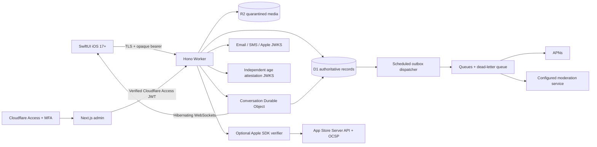

# System boundaries

Private fields are excluded from public profile DTOs. API reads use prepared statements. Admin user lists omit private identities and profile preferences. Only moderators can read evidence attached to a safety case. Audit every privileged request. Financial dashboards count entitlements; they do not fabricate revenue or churn.

Queues are at least once. Media moderation and notification delivery records are idempotent. Outbox delivery marks enqueue completion, not device delivery. An APNs accepted response is not evidence that a device displayed a notification. Live WebSockets do not survive snapshots; start the services again in each task.
